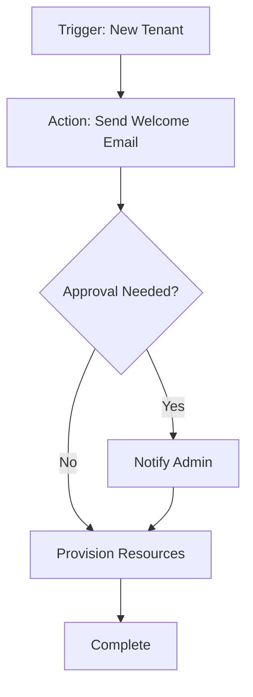

## Overview

OmniTruss provides a tenant-capable service platform designed for system houses. You can manage customer documentation, set up automation workflows, create self-service portals, and build custom apps efficiently. These core features enable scalable operations and enhanced customer experiences.

<Columns cols={2}>
  <Card title="Customer Documentation" icon="book-open" href="#customer-documentation">
    Create and manage dynamic documentation tailored to each tenant.
  </Card>
  <Card title="Automation Workflows" icon="zap" href="#automation-workflows">
    Automate repetitive tasks with powerful workflow engines.
  </Card>
  <Card title="Self-Service Portals" icon="users" href="#self-service-portals">
    Empower customers with intuitive self-service interfaces.
  </Card>
  <Card title="App Builder" icon="code" href="#app-builder">
    Build and deploy custom applications without deep coding expertise.
  </Card>
</Columns>

## Customer Documentation Tools

Use OmniTruss to generate and maintain customer-specific documentation. You upload templates, customize content per tenant, and publish instantly. This ensures accurate, up-to-date information for every client.

<Steps>
  <Step title="Create Template" icon="file-plus">
    Design your base document using the visual editor.

````markdown
```yaml
title: Customer Guide
sections:
  - id: intro
    content: Welcome to your service.
```
````
  </Step>
  <Step title="Assign to Tenant" icon="users">
    Link the template to specific tenants via the dashboard.
  </Step>
  <Step title="Publish" icon="upload">
    Generate and share unique docs for each customer.
  </Step>
</Steps>

<Callout kind="tip">
  Use version control to track changes and rollback if needed.
</Callout>

## Automation Workflows

Automate processes like onboarding, billing, and notifications. Define triggers, actions, and conditions using a no-code interface or API.



<CodeGroup tabs="JavaScript,Python">
````javascript
// Trigger workflow via API
const response = await fetch('https://api.example.com/v1/workflows/trigger', {
  method: 'POST',
  headers: { 'Authorization': 'Bearer YOUR_TOKEN' },
  body: JSON.stringify({ tenantId: 'tenant-123' })
});
````
````python
import requests

response = requests.post(
    'https://api.example.com/v1/workflows/trigger',
    headers={'Authorization': 'Bearer YOUR_TOKEN'},
    json={'tenantId': 'tenant-123'}
)
````
</CodeGroup>

## Self-Service Portals

Build portals where customers manage their accounts independently. Features include ticket submission, resource access, and status tracking.

<Tabs>
  <Tab title="Customer View" icon="user">
    Customers see personalized dashboards.

    <Image
      src="https://via.placeholder.com/600x400?text=Customer+Portal"
      alt="Screenshot of customer self-service portal"
      width="600"
      height="400"
    />
  </Tab>
  <Tab title="Admin View" icon="shield">
    Admins oversee all portals and analytics.
  </Tab>
</Tabs>

## App Builder Capabilities

The app builder lets you create custom applications for specific needs. Drag-and-drop UI components, integrate APIs, and deploy tenant-specific versions.

<Expandable title="Advanced Customization" default-open="false">
  Integrate with external services using webhooks.

  <ParamField path="webhookUrl" param-type="string" required="true">
    Your endpoint for receiving events.
  </ParamField>

  <ParamField header="X-Tenant-ID" param-type="string" required="true">
    Identifies the tenant in requests.
  </ParamField>
</Expandable>

<Board title="App Development Workflow">
  <BoardColumn title="Planned" color="0" icon="circle">
    <BoardCard title="Tenant Dashboard" description="Custom analytics view" dueDate="2024-12-15" />
  </BoardColumn>
  <BoardColumn title="In Progress" color="1" icon="loader">
    <BoardCard title="API Integrations" description="Connect to third-party services" author="Dev Team" />
  </BoardColumn>
  <BoardColumn title="Completed" color="2" icon="check-circle">
    <BoardCard title="Basic Forms" description="Self-service input forms" createdAt="2024-11-20" />
  </BoardColumn>
</Board>

<Callout kind="info">
  Explore these features in your OmniTruss dashboard at `https://dashboard.example.com` to get started.
</Callout>