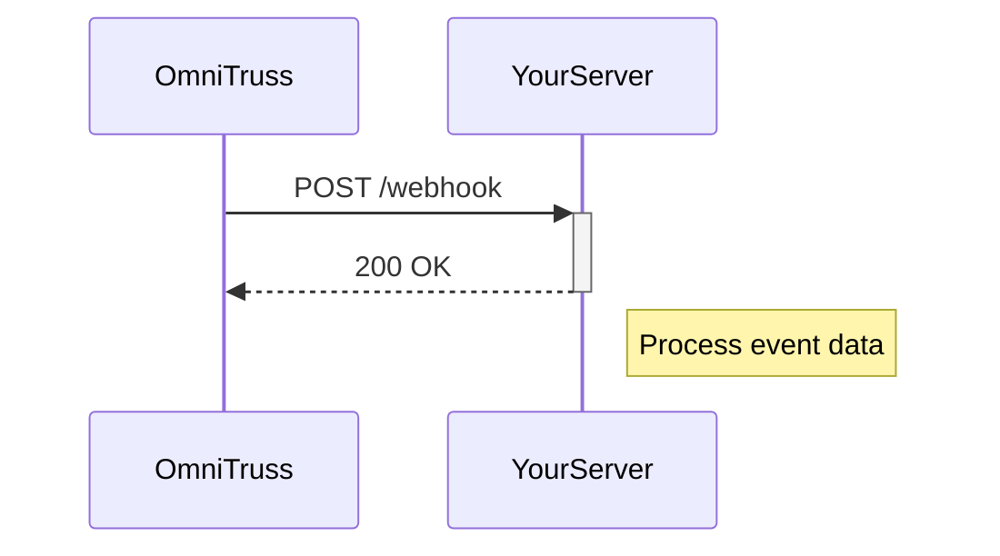

## Overview

OmniTruss supports seamless integrations with popular third-party tools to extend your service platform capabilities. Use webhooks for real-time notifications, API endpoints for data synchronization, and pre-built connectors for tools like Slack and Zapier. This guide covers supported tools, webhook setup, API overviews, and custom integration steps.

<Callout kind="tip">
  Start with webhooks for event-driven automations, then explore API endpoints for deeper customizations.
</Callout>

## Supported Third-Party Tools

Connect OmniTruss to these services for enhanced workflows, notifications, and automation.

<Columns cols={3}>
  <Card title="Slack" icon="message-circle" href="https://slack.com">
    Send real-time alerts for system events and customer updates.
  </Card>
  <Card title="Zapier" icon="zap" href="https://zapier.com">
    Build no-code automations connecting OmniTruss to 5000+ apps.
  </Card>
  <Card title="GitHub" icon="github" href="https://github.com">
    Automate deployments and sync repository events.
  </Card>
  <Card title="Stripe" icon="credit-card" href="https://stripe.com">
    Handle billing and subscription events securely.
  </Card>
  <Card title="Google Workspace" icon="mail" href="https://workspace.google.com">
    Integrate with Sheets, Drive, and Gmail for data management.
  </Card>
  <Card title="Zendesk" icon="headphones" href="https://zendesk.com">
    Sync tickets and customer support data.
  </Card>
</Columns>

## Webhook Configuration

Set up webhooks to receive OmniTruss events like user signups or system updates.

<Steps>
  <Step title="Create Webhook" icon="plus">
    Navigate to the Integrations dashboard at `https://dashboard.example.com/integrations`.
    
    Click "New Webhook" and enter your endpoint URL.
  </Step>
  <Step title="Configure Events" icon="settings">
    Select events such as `user.created` or `payment.failed`.
    
    Add optional filters like tenant ID.
  </Step>
  <Step title="Test and Activate" icon="zap">
    Send a test payload and verify receipt.
    
    Toggle to active once confirmed.
  </Step>
</Steps>

Example webhook payload:

<CodeGroup tabs="JavaScript,Python">
  ```javascript
  {
    "event": "user.created",
    "tenantId": "tenant-123",
    "data": {
      "id": "user-456",
      "email": "user@example.com"
    },
    "timestamp": "2024-01-15T10:30:00Z"
  }
  ```
  ```python
  {
      "event": "user.created",
      "tenantId": "tenant-123",
      "data": {
          "id": "user-456",
          "email": "user@example.com"
      },
      "timestamp": "2024-01-15T10:30:00Z"
  }
  ```
</CodeGroup>



## API Endpoints Overview

Use these endpoints to integrate programmatically. Authenticate with `Authorization: Bearer YOUR_TOKEN`.

<Request tabs="cURL,JavaScript" show-lines="true">
  ```bash
  curl -X POST https://api.example.com/v1/integrations/webhooks \
    -H "Authorization: Bearer YOUR_TOKEN" \
    -H "Content-Type: application/json" \
    -d '{
      "url": "https://your-webhook-url.com/webhook",
      "events": ["user.created"]
    }'
  ```
  ```javascript
  const response = await fetch('https://api.example.com/v1/integrations/webhooks', {
    method: 'POST',
    headers: {
      'Authorization': 'Bearer YOUR_TOKEN',
      'Content-Type': 'application/json'
    },
    body: JSON.stringify({
      url: 'https://your-webhook-url.com/webhook',
      events: ['user.created']
    })
  });
  ```
</Request>

<Response tabs="201,400">
  ```json
  {
    "id": "webhook-789",
    "url": "https://your-webhook-url.com/webhook",
    "events": ["user.created"],
    "active": true
  }
  ```
  ```json
  {
    "error": "Invalid URL",
    "message": "Webhook URL must be HTTPS"
  }
  ```
</Response>

<ParamField path="url" param-type="string" required="true">
  Your public HTTPS endpoint to receive payloads.
</ParamField>

<ParamField body="events" param-type="array" required="true">
  Array of event names like `["user.created", "payment.failed"]`.
</ParamField>

## Custom Integration Guides

Track your custom integrations with this sample roadmap.

<Board title="Integration Roadmap">
  <BoardColumn title="Planned" color="0" icon="calendar">
    <BoardCard title="Salesforce Sync" description="Bidirectional customer data" icon="database" dueDate="2024-12-15" />
    <BoardCard title="Microsoft Teams" description="Notification channels" icon="message-circle" />
  </BoardColumn>
  <BoardColumn title="In Progress" color="1" icon="loader">
    <BoardCard title="Custom API Bridge" description="GraphQL to REST adapter" author="Dev Team" />
  </BoardColumn>
  <BoardColumn title="Completed" color="2" icon="check-circle">
    <BoardCard title="Email SMTP" description="Custom mail server support" createdAt="2024-11-01" />
  </BoardColumn>
</Board>

<Tabs>
  <Tab title="Advanced Webhooks" icon="code">
    <Expandable title="Secret Validation" default-open="true">
      Validate payloads with HMAC signatures using `X-OmniTruss-Signature`.
      
````javascript
const crypto = require('crypto');
const signature = req.headers['x-omnitruss-signature'];
const hmac = crypto.createHmac('sha256', 'YOUR_WEBHOOK_SECRET');
hmac.update(JSON.stringify(payload));
if (hmac.digest('hex') !== signature) {
  throw new Error('Invalid signature');
}
````
    </Expandable>
  </Tab>
  <Tab title="Error Handling" icon="alert-triangle">
    Respond with 2xx status for success. Retry logic handles 5xx errors automatically.
  </Tab>
</Tabs>

<Callout kind="alert">
  Always use HTTPS for webhook URLs and validate signatures in production.
</Callout>